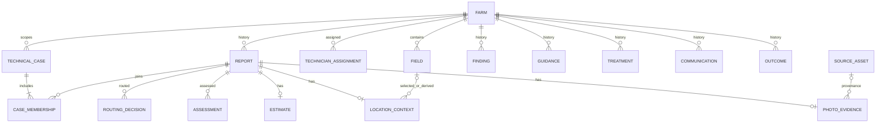

# Farm history and technical case data model

**Status: working DESIGN draft.** This conceptual/logical model supports the selected
prototype direction; it is not a schema, an approved routing policy or a dataset
specification. [UC-001](../specs/UC-001-REPORT-INTAKE.md) owns intake requirements;
the [routing worksheet](../reference/DMN-RULE-WORKSHEET.md) owns the selected
routing direction and its open policy questions. Group paper and model alignment is
pending. This draft does not change the active lifecycle phase.

Farm is the history hub: assemble its history from attributable records, including
routine reports, cases, findings, treatment, communications and outcomes. A history
view is not a second farm ledger of copied facts. A technical case is an operational
record created through technician involvement in P1, not a new C/F matrix business
case type. Communications is a responsibility for personalising and relaying established
advice; it does not assert a new Cooxupé department or make agronomic judgments.

## Source and decision trace

| Authority or status | What it establishes here |
| --- | --- |
| [Source map](../reference/README.md) and [group DOCX](<../../../Sharing is caring/The Case of the Brazilian Coffee Cooperative Cooxup├й.docx>) | The group paper owns the solution baseline and C/F matrix. Its P1 proposal uses optional GPS, photo/voice/text and a three-action DMN; it adds no department or C/F case type. The published case grounds organisation and AS-IS, not the proposed solution; its full chapter was unavailable and was not read for this draft. |
| Owner selections: [UC-001](../specs/UC-001-REPORT-INTAKE.md), [routing worksheet](../reference/DMN-RULE-WORKSHEET.md) | Camera-first with required location context and estimate; responsibility routing; independent reports and technician involvement for cases. These refinements differ from the group draft and need group alignment. |
| Agent proposals below | Field-scoped cases, link cardinalities, structure of context and relations, spatial representation and handoff. These are design recommendations, not owner or group decisions. The older [prototype concept](<../../../planning/PROTOTYPE-CONCEPT.md>) is supporting context, not authority over newer choices. |

The group paper also describes agronomic references, weather-zone event records,
optional pH and voice inputs. These are deferred integration/input extensions here,
not claims that they were absent from the solution baseline. Weather integration is
not required for the selected prototype routing direction.

## Entities and relationships

IDs below are conceptual keys, not prescribed columns. `0..*` means zero or more;
attributes marked optional may be unknown. The diagram shows the recommended case
cardinalities; context and relation links are separate from case membership.

| Entity | Key, important attributes and cardinality |
| --- | --- |
| Farmer / account | `farmer_id`, `account_id`, account-to-farm association. A target account identifies a farmer and farm; exact multiplicity and real authentication/authorization are open. A demo identity is explicitly simulated. |
| Farm | `farm_id`, fictional identity and optional labelled boundary. One farm has zero or more fields, reports and technician assignments. |
| Field | `field_id`, `farm_id`, optional versioned boundary, boundary source and synthetic flag. A field belongs to one farm; a report need not be assigned to a field when a GPS point cannot be grouped. |
| Technician assignment | `assignment_id`, technician, farm, effective period. Each assignment links one technician and one farm; both can have many assignments. Assigned farms are the minimum scope; access and cross-farm sharing remain open. |
| Report | `report_id`, farm, farmer/account reference, observation time and source, separate receipt time, optional narrative, estimate and location context. One farm has many reports; each report is independently retained. One original photo is required for new target submissions; legacy reports may lack it. |
| Photo evidence | `evidence_id`, report, original content/reference, media type and provenance. One report has one photo in the current target; retained legacy reports may have none. Dataset reuse links to source asset identity without changing the original evidence. |
| Estimate | Report-owned value, kind (count or percentage), unit, farmer-reported provenance and any area cue. New reports have one; legacy reports may have none. Count is plants; percentage is affected plants among all plants in the observed area, not land area or measured incidence. |
| Location context | Report-owned device point with accuracy, source and capture time, **or** farmer-selected field and retained boundary with field-level precision and source. Each new report has one usable context; a point may yield zero or one derived field under a rule still to be agreed. No point is implied by a boundary. |
| Assessment | `assessment_id`, report, inference, uncertainty, evidence references, model/prompt version and time. A report can have zero or more assessments; none is itself a confirmed finding. |
| Routing decision | `decision_id`, report, route, reason, rule/version, inputs and time. A report can have zero or more decisions over time; the route assigns responsibility, not relevance or a diagnosis. |
| Technical case | `case_id`, farm, optional field scope, status, technician involvement and dates. Recommended: one primary farm, optionally one field, with zero or more cases per farm/field. A case starts with technician involvement and at least one report; case scope and cardinality require agreement. |
| Case membership | `membership_id`, case, report, technician, time and reason. Recommended: a case has one or more reports; a report has zero or more memberships over time. Membership is a deliberate technician judgment, not a routing or proximity result. Whether simultaneous membership in multiple cases is allowed is open. |
| Context link | `context_id`, subject report or case, contextual report/case/record, candidate source (e.g. same farm or geometry), time and provenance. Zero or more links suggest or display context; they do not assert membership or relevance. Unmatched records remain visible in farm history. |
| Confirmed/rejected relation | `relation_id`, two reports or cases, relation kind, confirmed/rejected judgment, technician, reason and time. Zero or more record explicit human judgments and their provenance; a rejected proposed relation does not make the records generally irrelevant. |
| Finding | `finding_id`, farm, optional field/report/case references, finding, confirming actor and time. Zero or more confirmed findings are distinct from observations and inferences; preserve historical uncertainty when confirmation provenance is unknown. |
| Guidance, treatment, communication and outcome | Each has its own ID, farm, time, provenance and optional report/case reference. Guidance records established or technician-prepared advice; treatment records an action and its source; communication records personal relay and delivery status; outcome records what is known about resolution. Each farm may have zero or more of each. Delivery is not resolution. Purchase-history integration is outside scope. |
| Source asset / evaluation metadata | `asset_id`, dataset/version, original sample and parent IDs, attribution, licence status, transformations, labels and reuse links; synthetic scenario source and provenance are separately identified. Restricted labels and evaluation metadata are separated from operational report content and inference inputs. |

Diagram optionality permits legacy records; new intake has stricter requirements.
Context links and human relation judgments can connect different kinds of record and
are described in the table rather than implying a single foreign-key target in the
diagram. Farmer/account and staff identity relationships await access design.

## Invariants and interpretation

- Target intake derives farmer and farm from the signed-in account; the prototype may
  use a labelled simulated identity. GPS permission is neither login nor workflow gate.
  Automatically record observation time for camera capture and separately record UTC
  receipt. Label manually supplied or synthetic prototype stand-ins and their sources;
  an upload represents a new photo, not proof of capture time or device GPS.
- Prefer usable device GPS with point, reported accuracy, source and capture time.
  Otherwise select a known mapped field of the account's farm and retain its boundary
  and source. Do not replace the field with a fictitious observed point or centroid.
  GPS usability, boundary availability and the path when neither is available are open.
- Each new report has an approximate affected-plant count or percentage with an
  understandable observed-area basis. An optional area cue can help; no extra written
  narrative is mandatory. Do not invent area, acreage, a plant denominator, measured
  incidence or a conversion between count and percentage. Legacy missing values stay
  unavailable.
- A report is not a case, diagnosis or confirmed finding. Technician involvement creates
  or joins a suitable case; do not create a duplicate merely because a later report
  escalates. No rule requires every report to be consumed by a case or every routine
  report to be reviewed. A technician judges case membership and relevance; automatic
  non-matching, a DMN route or a rejected relation does not establish irrelevance.
- Keep all available farm context visible to the appropriate technician, subject to
  access rules still to be agreed. Nearby or same-farm context is a candidate, not
  proof of relevance. Separate observations, assessments and confirmed findings;
  retain the provenance of decisions, guidance, treatment, communication and outcomes.
  Severe actions require human approval; a route alone does not authorise them.
- Preserve data source and synthetic scenario context separately from operational
  records. A reused photo or related crop is not independent evidence. Keep current
  scoring labels and label-bearing identifiers out of inference inputs. The current
  photo remains assessment evidence. For evaluation, exclude answer-revealing history
  and duplicates/related crops used as contextual shortcuts, recording exclusions;
  ordinary prior findings remain legitimate history under the applicable policy. See the
  [open-data plan](../reference/OPEN-DATA.md).

## Spatial framework for later dataset design

Future fictional scenarios may use plausible Brazilian coordinates and labelled
fictional owners, histories and boundaries. Contrast elongated farms with many
external and few internal field neighbours with compact farms having many internal
and few external neighbours; also include irregular boundaries, gaps and corner
contacts. These are scenario goals, not claims about real farms or commitments to
counts, volumes or generation.

Derive field relationships from boundary geometry: internal adjacency relates fields
of the same farm; external adjacency relates fields of different farms. Proximity is a
separate distance relationship and does not imply touching. Define coordinate system,
boundary versions, distance/radius and whether point-only contact counts as adjacency
before use. Geometry can suggest context; it cannot determine agronomic relevance or
case membership. Cross-farm access and privacy remain open.

## Agreed direction, recommendations and next scope

| Topic | Selected direction / recommendation | Remaining decision |
| --- | --- | --- |
| Cases | Technician involvement only; link to an appropriate existing case when warranted. Recommend primary farm and optional field scope, with explicit report membership and related cases across farms or fields. | Case scope, multiple memberships, closure/reopening and cross-farm relation/access rules. |
| History | Farm is the hub; show unmatched context and retain original records. | Membership and ordering of history, nearby criteria, relevance workflow and permissions. |
| Intake | Camera-first, location and estimate required for new reports; upload is a prototype shortcut. | Demo identity and legacy mapping, area cue, GPS usability, boundary availability and no-location behavior. |
| Routing | DMN selects responsibility with reason; communications personalises and relays established guidance. | Routing definitions, severe approval, actor/access boundaries and reconciliation with group DOCX/BPMN/DMN. |
| Data/evaluation | Label synthetic data and protect scoring metadata. | Source suitability/licences, evaluation exclusion policy and eventual scenario design; no dataset generation now. |

**Minimum now:** use this model to reconcile intake and the independent routing
specification, identify the report/farm/history and location boundaries, and preserve
existing data. Assessment, routing, cases, spatial analysis and evaluation entities
are logical future interfaces, not implementation commitments for UC-001. Real account
authentication, transcription, offline capture and external messages are not implemented.

**Implemented demo and preservation:** [current domain](../../src/app/domain/reports.py)
and [SQLite adapter](../../src/app/infrastructure/sqlite.py) store farms, fields and
reports with required field, date and text, optional image and a finding embedded in a
report; history is earlier same-field reports. There is no account, boundary, estimate,
case or routing. [ADR-001](../adr/ADR-001-local-report-persistence.md) selects local
SQLite for the existing slice, not this revised model. A later migration design must
preserve IDs, original text/images, dates, receipts, findings and synthetic provenance;
record legacy time precision and missing estimate/location as unavailable rather than
inventing values, map fictional identities explicitly, and keep seed initialization
idempotent. No migration is specified or performed here.

**Bounded handoff:** owners resolve the intake and case choices above and align the
paper/models; specify routing separately as the worksheet requests. Then DESIGN can
map the agreed intake to domain, application service, repository interface, form and
SQLite adapter, compare migration alternatives, and propose an ADR only if an actual
consequential cross-use-case decision is ready for review. Validate with acceptance
examples for location fallback, estimate scope, legacy preservation, farm history,
independent reports, case linking and evidence separation. These are planned checks,
not evidence of implementation or approval. No ADR is proposed for unresolved options.
